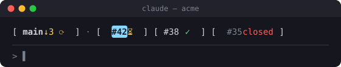
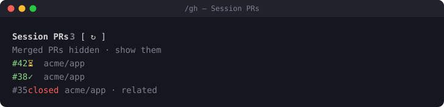
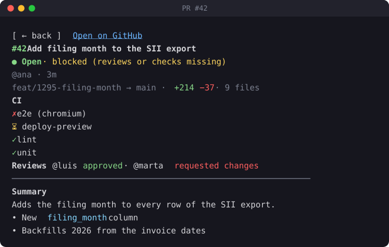

# claude-gh

**A [Claude Code](https://code.claude.com) plugin that keeps the PRs your session opens one key away: their CI, reviews and description, and merging them, without leaving the terminal.**



- **Only what this session touched.** The line above the prompt shows the PRs the session created or linked, not the whole repo.
- **CI you can read.** Press a PR to see its checks grouped by workflow, then a workflow to see its jobs, failed steps and the end of each failed log.
- **Merge from the pane.** Pick an allowed method, bypass the rules as an admin if you need to, and the main checkout's base branch is synced afterwards.

Built for running several sessions in parallel, each in its own worktree. It pairs well with [tokephobia](https://github.com/albertomarturelo/tokephobia), a worktree-aware status line, but doesn't need it.

## Install

From Claude Code:

```text
/plugin install claude-gh --marketplace albertomarturelo/claude-gh
```

Answer `y` to add the marketplace, then pick a scope. From a shell, use `claude plugin install claude-gh --marketplace albertomarturelo/claude-gh`.

You need [`gh`](https://cli.github.com) logged in (`gh auth login`) and `git`. The plugin loads in sessions started after installing it.

## What you see

### The line above the prompt

```
[ main ↓3 ⟳ ] · [ #42 ⏳ ] [ #38 ✓ ] [ #35 closed ] [ +2 ]
```

- **Base branch:** where the main checkout's `main` (origin's default branch) stands against origin: `✓` up to date, `↓3` behind, `↑1` with local commits, `✎` uncommitted changes, `⚠` the last fetch failed. It fetches every 2 minutes, which only moves remote refs. Pressing it (or `ctrl+x tab` then `s`) syncs, fast-forward only: `git pull --ff-only` when the main checkout has `main` out and is clean, `git fetch origin main:main` when it's on another branch. With uncommitted changes, or when `main` has diverged, it does nothing and says why.
- **Session PRs:** the PRs this session created or linked, with their state: `✓` CI passing, `✗` failing, `⏳` running, `draft`, `merged`, `closed`. PRs it only linked are dimmed. Open ones come first, and the line shows four; `+N` opens the pane with all of them.

Press a PR to open it in the pane; press it again to close the pane. Merged PRs are hidden by default: turn **Hide merged session PRs** off in `/config`, or press `h` in the pane, to see them.

### The pane



`/gh` opens the pane with every PR of this session. Press `r` to refresh it.

### PR detail



- **State:** `● Merged by @x 2h ago`, `● Closed without merging`, or `● Open` with whether it can merge (ready, has conflicts, blocked, behind the base branch).
- **Change:** branch, base, lines added and removed, and files changed.
- **CI:** grouped by workflow, failing ones first, with how many jobs failed and how long it took. Checks from outside GitHub Actions are listed as they are.
- **Reviews:** each reviewer's latest review.
- **Description:** the body, rendered as Markdown.

`← back` (`b`) returns to the list, **Open on GitHub** (`o`) opens it in the browser, and **↻ Refresh** (`r`) reloads it. A PR with checks still running refreshes by itself every 20 seconds.

**⇥ Merge** (`m`) merges an open PR. It first asks which method to use, offering only those the repo allows: squash (`s`), merge commit (`c`) or rebase (`e`). Drafts and PRs with conflicts say why they can't be merged instead. If you're an admin of the repo, it also offers **Merge as admin** (`a`), which merges with `gh pr merge --admin`, bypassing required reviews and checks. It starts off. Merging into `main` syncs the main checkout's `main` afterwards.

### Workflow runs

Press a workflow in a PR's CI section to see its run:

- **Jobs:** each one with its duration. Pressing a job opens it on GitHub.
- **Failures:** the steps that failed, and the end of each failed job's log, up to the error.
- **Running workflows:** the view refreshes every 10 seconds while it runs.
- **Re-run failed jobs** (`f`): it asks before calling `gh run rerun --failed`, because that starts CI again on GitHub.

In fullscreen mode, from 110 columns wide, the pane docks beside the conversation; otherwise it opens above the prompt.

## How it works

- **Session PRs:** Claude Code records them in the session's transcript: `pr-link` entries for every PR the session links, and `gitOperation.pr` for the ones it creates. The plugin reads the transcript incrementally every 15 seconds, only what was added since the last read, so parallel sessions never mix.
- **PR state and CI:** `gh pr view` for each session PR, every minute while it's open and every 15 minutes once it's merged or closed.
- **Everything else** (detail, runs, logs, merging) calls `gh` when you open it.

## Development

```sh
npm test            # claude plugin test plugin
npm run typecheck   # needs the types Claude Code generates in plugin/.claude-plugin/ when it loads the plugin
```

## License

MIT
